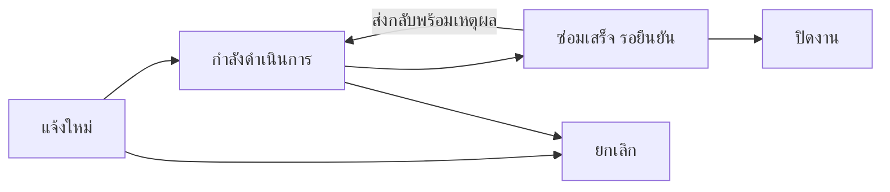

# SVP Factory Intranet — คู่มือระบบ

ปรับปรุง 14 ตุลาคม 2026 · ต่อยอด PHP MVC และ MySQL เดิม

## ส่วนงานที่เปิดใช้

| ส่วนงาน | ความสามารถ |
|---|---|
| บุคลากร | ทะเบียนผู้ใช้ แผนก ตำแหน่ง บทบาท และสถานะใช้งานตามระบบเดิม |
| อุปกรณ์ | ทะเบียน ประเภท แผนก ผู้รับผิดชอบ และการค้นหาตามระบบเดิม |
| PM | แผนตามรอบ ปฏิทิน ประวัติผลจริง ไฟล์ PDF และการคาดการณ์รอบปีถัดไป |
| แจ้งซ่อม | ระบุอุปกรณ์/สถานที่ ประเภท ความเร่งด่วน วันต้องการ PDF ประกอบ มอบหมายงาน และติดตามสถานะ |
| คำขออนุมัติ | ขอจัดซื้อ ขอสิทธิ์ ขอใช้อุปกรณ์ หรือทั่วไป เลือกผู้อนุมัติหนึ่งคน บันทึกเหตุผลและผลตัดสิน |
| เอกสาร | Document Control เดิม พร้อมเวอร์ชัน ประวัติ และการเชื่อม SharePoint ตามการตั้งค่าเดิม |
| ประกาศ | ร่าง เผยแพร่ตามวัน เก็บเข้าคลัง ระบุแผนก ปักหมุด และรับทราบประกาศ |
| หน้าหลัก | สรุปงานซ่อม คำขอ รอฉันอนุมัติ แจ้งเตือน ประกาศ และ PM ที่ถึงกำหนด |

รายการงาน ประกาศ และการแจ้งเตือนแบ่งหน้าละ 15 รายการ ตัวกรองคงอยู่เมื่อเปลี่ยนหน้า ส่วนตาราง PM ใช้การแบ่งหน้าเดิมและปฏิทินดูข้อมูลทั้งชุด

## ขั้นตอนแจ้งซ่อม

1. เลือก **แจ้งซ่อม / ติดตามงาน → แจ้งซ่อม** แล้วระบุปัญหา
2. ผู้จัดการหรือผู้ดูแลมอบหมายผู้รับงาน ผู้รับงานหรือผู้จัดการเริ่มดำเนินการ
3. ผู้ปฏิบัติงานเลือก **บันทึกผลซ่อมเสร็จ** พร้อมรายละเอียดผลซ่อม
4. ผู้แจ้งหรือผู้จัดการตรวจรับแล้ว **ยืนยันปิดงาน** หรือ **ส่งกลับแก้ไข** พร้อมเหตุผล
5. เปิดดูประวัติและเพิ่มข้อความได้จากหน้ารายละเอียด



## ขั้นตอนคำขออนุมัติ

เลือก **คำขออนุมัติ → ยื่นคำขอ** กรอกเหตุผลและเลือกผู้อนุมัติที่ใช้งานอยู่ ผู้อนุมัติต้องมีบทบาท manager หรือ admin และเป็นคนละคนกับผู้ยื่น

- ผู้อนุมัติเปิดจาก **รอคุณอนุมัติ** บนหน้าหลัก หรือตัวกรอง **ฉันเป็นผู้อนุมัติ**
- อนุมัติหรือไม่อนุมัติได้เฉพาะคนที่ถูกเลือก การไม่อนุมัติต้องมีเหตุผล
- ผู้ยื่นยกเลิกได้ขณะรอผล โดยระบุเหตุผล
- ผลที่ตัดสินแล้วแก้ย้อนกลับไม่ได้ หากข้อมูลเปลี่ยนให้ยื่นคำขอใหม่
- การอนุมัติเป็นการบันทึกผลภายในระบบ ไม่ได้สร้างใบสั่งซื้อหรือให้สิทธิ์ในระบบอื่นอัตโนมัติ

## สิทธิ์การเข้าถึง

| การกระทำ | ผู้ใช้ทั่วไป | ผู้จัดการ | ผู้ดูแล |
|---|---|---|---|
| ดูแจ้งซ่อม | งานที่ยื่นหรืองานที่ได้รับมอบหมาย | ทุกงาน | ทุกงาน |
| มอบหมายงานซ่อม | ไม่ได้ | ได้ | ได้ |
| ดูคำขอ | ของตนหรือที่เลือกตนเป็นผู้อนุมัติ | ของตนหรือที่เลือกตนเป็นผู้อนุมัติ | ทุกคำขอ |
| ตัดสินคำขอ | ไม่ได้ | เฉพาะที่เลือกตนเป็นผู้อนุมัติ | เฉพาะที่เลือกตนเป็นผู้อนุมัติ |
| จัดการประกาศ | ไม่ได้ | ได้ | ได้ |
| ดูประกาศปกติ | ที่เผยแพร่ถึงแผนกตนหรือทุกแผนก | เช่นเดียวกัน; หน้าจัดการดูได้ทั้งหมด | เช่นเดียวกัน; หน้าจัดการดูได้ทั้งหมด |
| การแจ้งเตือน | เฉพาะตนเอง | เฉพาะตนเอง | เฉพาะตนเอง |

Document Control ใช้สิทธิ์เดิม: admin หรือผู้ใช้ที่ใช้งานอยู่ในแผนก DCC หมายเลข 13 การดาวน์โหลดไฟล์งานตรวจสิทธิ์รายการทุกครั้ง

## ประกาศและการแจ้งเตือน

ประกาศจะเห็นเมื่อสถานะเป็นเผยแพร่และอยู่ในช่วงวันที่ที่ตั้งไว้ ผู้รับกดรับทราบได้ ผู้จัดการดูรายชื่อผู้รับทราบได้ หากแก้หัวข้อ เนื้อหา หรือกลุ่มผู้รับ ระบบจะล้างการรับทราบเก่าเพื่อให้อ่านฉบับใหม่

การแจ้งเตือนเป็นกล่องข้อความภายในเว็บ: แจ้งงานซ่อมใหม่ไปยังผู้จัดการ/ผู้ดูแล แจ้งคำขอใหม่ไปยังผู้อนุมัติ และแจ้งการเปลี่ยนแปลงไปยังผู้ยื่น ผู้รับงาน และผู้อนุมัติที่เกี่ยวข้อง ยกเว้นคนที่ทำรายการเอง รุ่นนี้ยังไม่มีอีเมลหรือ LINE และรองรับผู้อนุมัติหนึ่งคนต่อคำขอ

## แยกเครื่องจักรและอุปกรณ์ IT

เมนูด้านซ้ายแยก **อุปกรณ์ IT** (`/it-devices`) และ **เครื่องจักร** (`/machines`) เป็นคนละหน้า แต่ละหน้าแสดงเฉพาะกลุ่มนั้น ปุ่มเพิ่มเลือกกลุ่มให้ล่วงหน้า ส่วน **ทะเบียนรวม** ใช้ดูข้อมูลทุกกลุ่มและจัดการ Excel

หน้า **ทะเบียนอุปกรณ์** มีตัวกรอง ทั้งหมด / อุปกรณ์ IT / เครื่องจักร / ยังไม่จัดกลุ่ม การค้นหา เรียงลำดับ และเปลี่ยนหน้าจะคงกลุ่มที่เลือกไว้ ผู้ดูแลเลือกกลุ่มได้จากหน้าเพิ่มหรือแก้ไขอุปกรณ์ ส่วนประเภทอุปกรณ์เป็นชนิดย่อยและเพิ่มได้ที่เมนูประเภทอุปกรณ์

ข้อมูลที่ตรวจเมื่อ 14 ตุลาคม 2026 มี Desktop 9, Laptop 55 และ Printer 1 รายการ จัดเป็น IT แล้ว รวม 65 รายการ ยังไม่มีรายการเครื่องจักร การจัดกลุ่มใช้รหัสอุปกรณ์เดิมจึงคงความเชื่อมโยงกับแผน PM และงานซ่อม

เครื่องอื่นที่นำโค้ดนี้ไปใช้ต้องรัน `C:\xampp\php\php.exe database\migrate_device_groups.php` เพิ่มคอลัมน์และจัดประเภท IT ที่รู้จัก สคริปต์ไม่เขียนทับกลุ่มที่เลือกไว้แล้ว ข้อมูลชนิดที่ไม่รู้จักจะอยู่ในกลุ่มยังไม่จัดกลุ่ม ส่วน Excel เดิมยังไม่รวมคอลัมน์กลุ่ม: การแก้ไขแถวเดิมคงกลุ่มเดิม และรายการใหม่ที่นำเข้าต้องเลือกกลุ่มในหน้าแก้ไขอุปกรณ์

## กติกา PM

- แผนและวันคาดการณ์ไม่ใช่หลักฐานว่าทำ PM เสร็จ
- บันทึกผลจริงห้ามใช้วันอนาคต และใช้เวลา Asia/Bangkok
- เฉพาะผล `completed` จึงเลื่อนวันครบกำหนด ผล `partial` และ `issue_found` คงรอบเดิม
- ปฏิทินแสดงรอบคาดการณ์ตามจำนวนวันในแผน และแยกป้ายคาดการณ์จากกำหนดจริง
- วันครบกำหนดที่ค้างยังแสดงอยู่ ไม่ถูกแทนด้วยปีที่เลือก
- รอบใช้จำนวนวัน เช่น 365 วัน จึงอาจต่างจากวันครบรอบปฏิทินเมื่อผ่านปีอธิกสุรทิน

## ติดตั้งและดูแล

ฐานข้อมูลของเครื่องนี้เพิ่มตารางใหม่แล้ว โดยไม่ได้สร้างงาน/ประกาศตัวอย่างในข้อมูลจริง หากนำโค้ดไปยังเครื่องอื่น ให้สำรองฐานข้อมูลและโฟลเดอร์ uploads แล้วรันจากรากโครงการ:

```powershell
C:\xampp\php\php.exe database\migrate_intranet.php
```

สคริปต์เป็น CLI เท่านั้น และสร้างเฉพาะตารางที่ยังไม่มี: work_items, work_events, announcements, announcement_reads, portal_notifications รันซ้ำได้ โครงสร้างตารางเดิมไม่ถูกเปลี่ยน

ไฟล์งานรองรับ PDF ไม่เกิน 10 MB เก็บที่ `public/uploads/work` ภายใต้ข้อห้ามเข้าตรงของ uploads ควรสำรองไฟล์และฐานข้อมูลเป็นชุดเดียวกัน ขีดจำกัดอัปโหลดของ PHP ต้องรองรับขนาดนี้ด้วย

## การตรวจสอบรุ่นนี้

- ทดสอบใน SQLite แยกจากข้อมูลจริง: regression, intranet, calendar, dashboard, document_control, document_control_access, search
- ทดสอบสิทธิ์ การเปลี่ยนสถานะ การอนุมัติตัวเอง การแก้ไขพร้อมกัน และการย้อนธุรกรรมเมื่อบันทึกไม่ครบ
- PDF ภาษาไทยผ่านการสร้างทั้งสามแบบเดิม
- คำสั่งอ่านข้อมูลโมดูลใหม่ผ่าน MySQL จริงด้วย `tests/intranet_live_read.php` (อ่านอย่างเดียว)
- ตรวจหน้ารายละเอียดและฟอร์มด้วยข้อมูลตัวอย่างในเบราว์เซอร์ รวมถึงขนาดมือถือและเมนูมือถือ
- ยังไม่ได้ส่งฟอร์มหลังเข้าสู่ระบบจริงผ่านเบราว์เซอร์; ขั้นตอนบันทึกทดสอบในฐานข้อมูลแยก การล็อกแถวพร้อมกันบน MySQL ยังไม่ได้ทดสอบโหลดหลายผู้ใช้

```powershell
C:\xampp\php\php.exe tests\intranet.php
C:\xampp\php\php.exe tests\calendar.php
C:\xampp\php\php.exe tests\dashboard.php
C:\xampp\php\php.exe tests\document_control.php
C:\xampp\php\php.exe tests\document_control_access.php
C:\xampp\php\php.exe tests\search.php
C:\xampp\php\php.exe tests\pdf_smoke.php
```

ข้อความ simulated failure ในชุด regression เป็นการจำลองความผิดพลาดเพื่อตรวจว่าธุรกรรมย้อนกลับได้
