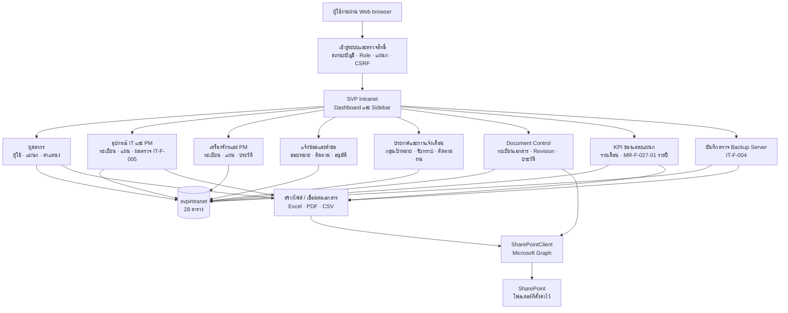
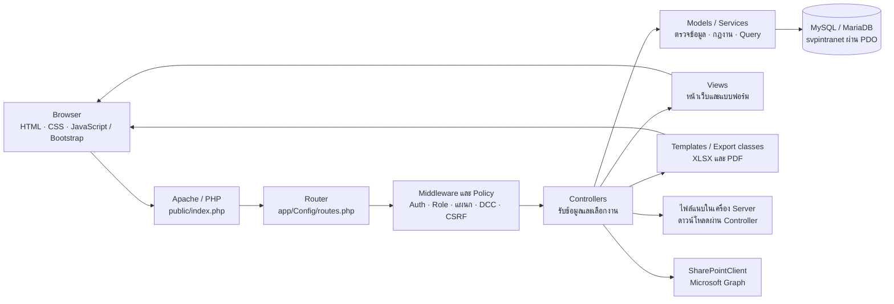
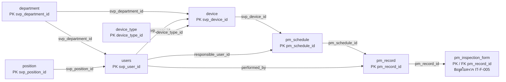
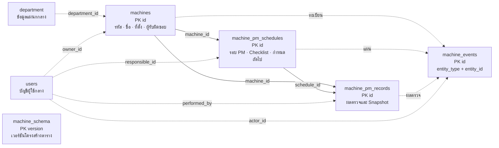
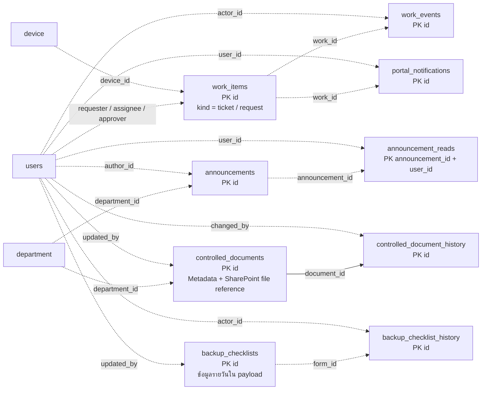
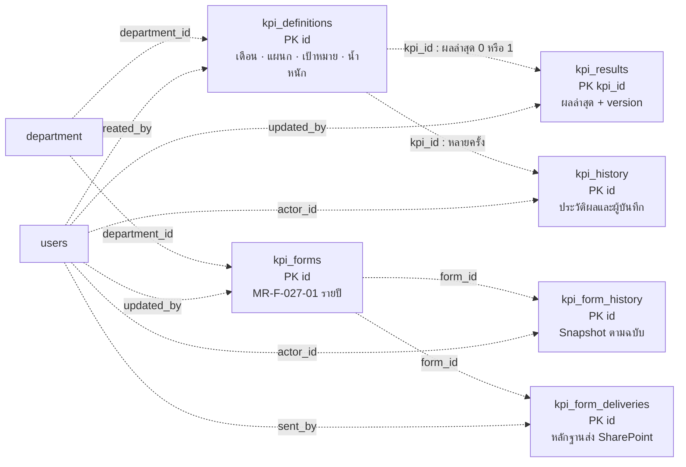
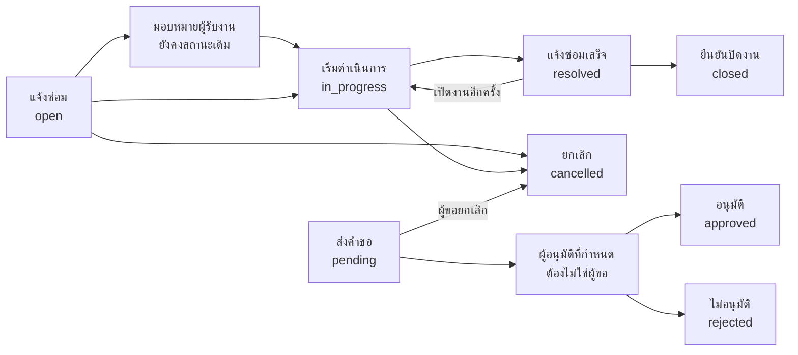
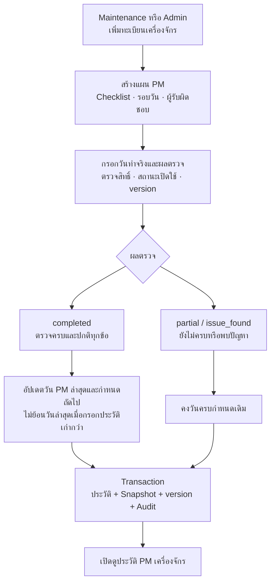
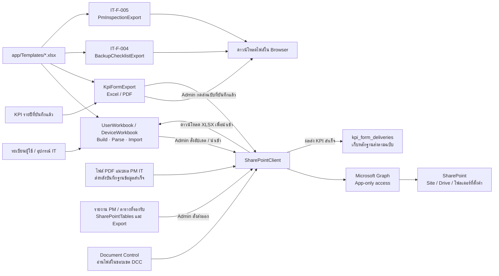

# SVP Intranet — System diagrams

ตรวจโค้ดและ metadata ของฐานข้อมูลจริงวันที่ 25 ตุลาคม 2026 (Asia/Bangkok)

ปรับคำอธิบายสิทธิ์แจ้งซ่อมวันที่ 26 ตุลาคม 2026: ผู้ใช้ทุกแผนกรวม DCC แจ้งซ่อมได้หลังเข้าสู่ระบบ โดย DCC เปิดเฉพาะงานของตน/ที่ได้รับมอบหมาย ไม่ได้เปิดโมดูลคำขออนุมัติ

เมื่อบันทึกซ่อมเสร็จ ระบบแจ้งเตือนผู้แจ้งใน Intranet ให้ตรวจสอบและยืนยันปิดเคสหรือส่งกลับแก้ไข กระดิ่งด้านบนแสดงจำนวนที่ยังไม่อ่านเมื่อโหลดหน้า DCC อ่านและทำเครื่องหมายแจ้งเตือนงานซ่อมของตน/ที่ได้รับมอบหมายได้ การอ่านแจ้งเตือนไม่ใช่การยืนยันปิดเคส ผู้จัดการ/Admin ยังปิดแทนได้ตามสิทธิ์เดิมโดยบันทึกผู้ดำเนินการจริง

Maintenance รับงานเครื่องจักรสถานะแจ้งใหม่ที่ยังไม่มอบหมายให้ตนเองได้ด้วยปุ่ม “รับงานและเริ่มซ่อม” จากนั้นบันทึกผลด้วย “ซ่อมเสร็จ / แจ้งผู้แจ้งตรวจรับ” การเพิ่มข้อความไม่เปลี่ยนสถานะใบงาน

เอกสารนี้อธิบายระบบที่มีอยู่ในปัจจุบัน ไม่ใช่รายการฟีเจอร์ที่วางแผนไว้ ฐานข้อมูลหลักคือ `svpintranet` มี 28 ตาราง เครื่องจักรและ IT แยก **ตาราง** โดยใช้ฐานข้อมูลและบัญชีผู้ใช้กลางร่วมกัน

ไฟล์ [svp-intranet-system.drawio](diagrams/svp-intranet-system.drawio) เปิดแก้ไขด้วย draw.io ได้ มี 9 หน้า ตรงกับ Diagram ด้านล่าง และมี Mermaid แยกเป็น `diagrams/01-system.mmd` ถึง `09-system.mmd` การแก้เอกสารแล้วรัน `python docs/diagrams/build_system_diagrams.py` จะสร้างไฟล์เหล่านี้ใหม่

## 1. ภาพรวมระบบ

เส้นในภาพรวมแสดงการพึ่งพาของโมดูล ไม่ได้หมายความว่าทุกปุ่มบันทึกส่งไป SharePoint อัตโนมัติ การเชื่อมต่อแต่ละชนิดอยู่ในภาพที่ 9

## 2. โครงสร้างการทำงานของเว็บ

AuthMiddleware อ่านสถานะผู้ใช้ล่าสุดจากฐานข้อมูลก่อนใช้งาน แต่ละโมดูลมี Policy เพิ่มเติม การตรวจ version และ transaction มีในงานที่รองรับ เช่น KPI, เครื่องจักร, ใบงาน, ประกาศ, Document Control และ Backup; ไม่ควรตีความว่าทุกตารางมี audit หรือ version เหมือนกัน

## 3. ฐานข้อมูล: บุคลากร / อุปกรณ์ IT / PM

สัญลักษณ์สำหรับภาพฐานข้อมูล 3–6: **เส้นทึบ = มี Foreign Key จริง**, **เส้นประ = ความสัมพันธ์ที่โค้ดใช้งาน ไม่มี Foreign Key ในฐานที่ตรวจ** เส้นชี้จากตารางแม่ไปตารางที่อ้างอิง ไม่ใช่ทิศทางการไหลของข้อมูล

อุปกรณ์หนึ่งรายการมีหลายแผน แผนหนึ่งมีหลายประวัติ ประวัติ PM หนึ่งรายการมีแบบ IT-F-005 ได้ไม่เกินหนึ่งชุด ประวัติเก่าที่ไม่มีแบบฟอร์มยังอยู่ใน `pm_record`

## 4. ฐานข้อมูล: เครื่องจักร / แผนและประวัติ PM

`machine_events` อ้างอิงหลายชนิดรายการผ่าน `entity_type` ไม่ใช่ FK สามชุด ส่วน `machine_schema` เป็นตารางกำกับการติดตั้ง ไม่มีความสัมพันธ์กับรายการเครื่องจักร

ไม่มีการใช้ `device.svp_device_id` แทน `machines.id` แม้เลขเท่ากัน ชื่อเครื่องจักร แผน และรายการตรวจในประวัติเก็บเป็น snapshot เพื่อคงข้อมูลในวันที่บันทึก

## 5. ฐานข้อมูล: ใบงาน / ประกาศ / เอกสาร / Backup

ใบแจ้งซ่อมและคำขอใช้ตารางเดียวกัน แต่กฎสถานะและผู้มีสิทธิ์ต่างกัน `work_items.device_id` ยังอ้างถึงทะเบียน IT ไม่ใช่ทะเบียน `machines` ใหม่ หมวดงาน “เครื่องจักร” ในใบงานเป็นการจัดประเภท ไม่ใช่การเชื่อม FK ไปยังทะเบียนเครื่องจักร

## 6. ฐานข้อมูล: KPI แผนก

KPI ใหม่เป็นระดับแผนก (`kpi_definitions.user_id = NULL`) พนักงานรวม DCC สร้างและกรอกผลได้เฉพาะแผนกตนเอง Admin จัดการได้ทุกแผนก ผลรายเดือนกับเอกสารรายปีเป็นคนละชุด **ยังไม่ได้ซิงก์ตัวเลขข้ามกันอัตโนมัติ** ผลอัตโนมัติของรายเดือนอ่าน `pm_record`, `work_items`, `work_events` และแผนกปัจจุบันของผู้ทำงาน ไม่ได้รวม `machine_pm_records`

## 7. Workflow แจ้งซ่อมและคำขออนุมัติ

การมอบหมายทำได้ขณะ open/in_progress และไม่เปลี่ยนสถานะ ผู้จัดการ/Admin หรือผู้รับงานดำเนินการซ่อม ส่วนการปิด/เปิดงานอีกครั้งเป็นของผู้ขอหรือผู้จัดการ/Admin การอนุมัติคำขอต้องเป็นผู้อนุมัติที่ระบุและมี role manager/admin ทุกการเปลี่ยนแปลงผ่านกฎใน `WorkItem::actions()` และมี event/notification

## 8. Workflow PM เครื่องจักร

ภาพนี้อธิบายโมดูลเครื่องจักรใหม่ ไม่ใช่การยืนยันว่าการตรวจ version/active-state ของ PM ฝั่ง IT ใช้ implementation เดียวกัน ไม่สร้างผลตรวจสำเร็จจากแผนในอนาคต

## 9. Excel / PDF / SharePoint

- KPI: บันทึกฟอร์มก่อน แล้ว Admin เลือกชนิดไฟล์และปลายทางเพื่อส่ง ไม่ส่งทุกครั้งที่พนักงานบันทึก
- PM IT: PDF ที่ผู้ใช้แนบถูกส่งหลัง commit และมีปุ่มให้ Admin ส่งซ้ำ การ Export ใบตรวจ IT-F-005 เป็นอีกการทำงานหนึ่ง ไม่ใช่การส่งใบตรวจที่สร้างใหม่อัตโนมัติ
- Backup IT-F-004: บันทึกและ Export ในเครื่อง ยังไม่มีเส้นทางส่ง SharePoint ของโมดูลนี้
- PM เครื่องจักร: ยังไม่มี Export/SharePoint ของโมดูลใหม่
- การมีโค้ดเชื่อมต่อไม่ใช่หลักฐานว่าบริการภายนอกพร้อมใช้งาน ณ เวลานี้ งาน Diagram นี้ไม่ได้ส่งไฟล์หรือทดสอบ Microsoft Graph จริง

## 10. สิทธิ์ใช้งานตามโค้ดปัจจุบัน

| ส่วนงาน | ผู้มีสิทธิ์หลัก | ขอบเขต |
|---|---|---|
| จัดการผู้ใช้/แผนก/ตำแหน่ง/ประเภทอุปกรณ์ | Admin | เพิ่ม แก้ไข ลบตาม route |
| ทะเบียนอุปกรณ์รวม | ผู้เข้าสู่ระบบที่ไม่ถูกจำกัด DCC | ดู; เพิ่ม/แก้ไข/ลบเป็น Admin |
| ตัวกรองเฉพาะอุปกรณ์ IT | แผนก IT (2) และ Admin | `/it-devices` หรือ group=it |
| แผน PM ฝั่ง IT/ทะเบียนเดิม | ผู้เข้าสู่ระบบที่ไม่ถูกจำกัด DCC | เพิ่ม/แก้ไขแผนเป็น Admin/manager; ลบเป็น Admin |
| บันทึก/ดู PM ฝั่ง IT | ผู้เข้าสู่ระบบที่ไม่ถูกจำกัด DCC | ตรวจตาม route และ validation ของโมดูลเดิม |
| เครื่องจักรและ PM | Maintenance (6) ทุก role และ Admin | เพิ่ม/แก้ไขทะเบียน แผน และบันทึกผล |
| Backup IT-F-004 | IT (2) และ Admin | สร้าง แก้ไข กรอกผล ส่งออก |
| KPI รายเดือน/รายปี | พนักงานทุกแผนก รวม DCC | เฉพาะแผนกตน; Admin ทุกแผนก |
| แจ้งซ่อม | ผู้เข้าสู่ระบบทุกแผนก รวม DCC และผู้ยังไม่สังกัดแผนก | สร้างได้ทุกคน; ผู้ขอ/ผู้รับงานเห็นงานที่เกี่ยวข้อง; Maintenance เห็นคิวเครื่องจักรแม้ยังไม่มอบหมาย; manager ที่ไม่อยู่ใน DCC และ Admin จัดการภาพรวม |
| คำขออนุมัติ | ผู้ขอ/ผู้อนุมัติ/Admin | อนุมัติต้องเป็นผู้อนุมัติที่ระบุ มี role manager/admin และไม่ใช่ผู้ขอ |
| ประกาศ | ผู้มีสิทธิ์และอยู่ในกลุ่มเป้าหมาย | manager/Admin จัดการ; DCC non-admin ยังจำกัดตาม workspace |
| Document Control | DCC (13) และ Admin | ทะเบียนเอกสารและไฟล์ในขอบเขตที่กำหนด |
| SharePoint ทั่วไป / ส่ง KPI | Admin | พนักงานกรอก KPI ได้ แต่กดส่ง SharePoint ไม่ได้ |

สิทธิ์เป็นการผสม role + แผนก + สถานะบัญชี + เจ้าของรายการ จึงไม่ควรใช้ภาพ Role อย่างเดียวแทนเงื่อนไขใน Controller/Model บัญชีที่ปิดใช้งานถูกปฏิเสธโดย AuthMiddleware

## 11. รายการตารางครบ 28 ตาราง

| กลุ่ม | ตาราง |
|---|---|
| บุคลากร (3) | `department`, `position`, `users` |
| อุปกรณ์ IT และ PM (5) | `device_type`, `device`, `pm_schedule`, `pm_record`, `pm_inspection_form` |
| เครื่องจักร (5) | `machines`, `machine_pm_schedules`, `machine_pm_records`, `machine_events`, `machine_schema` |
| ใบงานและแจ้งเตือน (3) | `work_items`, `work_events`, `portal_notifications` |
| ประกาศ (2) | `announcements`, `announcement_reads` |
| Document Control (2) | `controlled_documents`, `controlled_document_history` |
| Backup (2) | `backup_checklists`, `backup_checklist_history` |
| KPI รายเดือน (3) | `kpi_definitions`, `kpi_results`, `kpi_history` |
| KPI รายปี (3) | `kpi_forms`, `kpi_form_history`, `kpi_form_deliveries` |

Foreign Key จริงที่ตรวจพบมี 14 ความสัมพันธ์ แสดงครบในภาพ 3–5 ส่วนตารางที่ไม่มี FK ยังอาจตรวจความสัมพันธ์ด้วยโค้ด ตารางที่มี payload เก็บรายละเอียดแบบฟอร์ม/snapshot ใน JSON จึงไม่ได้มีตารางลูกสำหรับทุกช่องกรอก

## 12. จุดที่ยังไม่เชื่อมอัตโนมัติ

1. ทะเบียนเครื่องจักรใหม่ → `work_items`: ยังไม่มี `machine_id` สำหรับเลือกเครื่องจักรใหม่ในใบแจ้งซ่อม
2. PM เครื่องจักร → KPI อัตโนมัติ / Dashboard PM เดิม / SharePoint PM เดิม: ยังไม่รวมข้อมูลตารางใหม่
3. KPI รายเดือน ↔ แบบ MR-F-027-01 รายปี: ยังไม่ดึงผลหรือคะแนนข้ามกัน
4. Approved by ในแบบฟอร์ม: เป็นชื่อในเอกสาร ไม่ใช่ workflow อนุมัติหรือลายเซ็นดิจิทัล
5. ฐาน `svp_machines` ที่เคยสร้างแยกไว้ไม่ได้ถูกใช้งานแล้ว; `MachineDatabase::connect()` ใช้ connection ของ `svpintranet`

## แหล่งอ้างอิงภายในโครงการ

- `app/Config/routes.php`, `app/Core/Router.php`, `app/Middleware/*`
- `app/Core/MachineAccess.php`, `app/Core/KpiPolicy.php`, `app/Core/DccWorkspace.php`, `app/Core/DocumentControlAccess.php`, `app/Core/ItDeviceAccess.php`
- `app/Models/*`, `app/Controllers/*`, `app/Core/*Export.php`, `app/Core/SharePointClient.php`
- `database/*.sql` และ `information_schema` ของฐานจริง (ตรวจเฉพาะโครงสร้าง ไม่อ่านข้อมูลผู้ใช้)
- คำอธิบายเพิ่มเติม: `MACHINES.md`, `KPI.md`, `IT_BACKUP.md`, `PM_INSPECTION.md`
